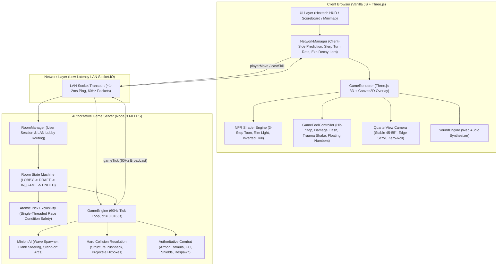
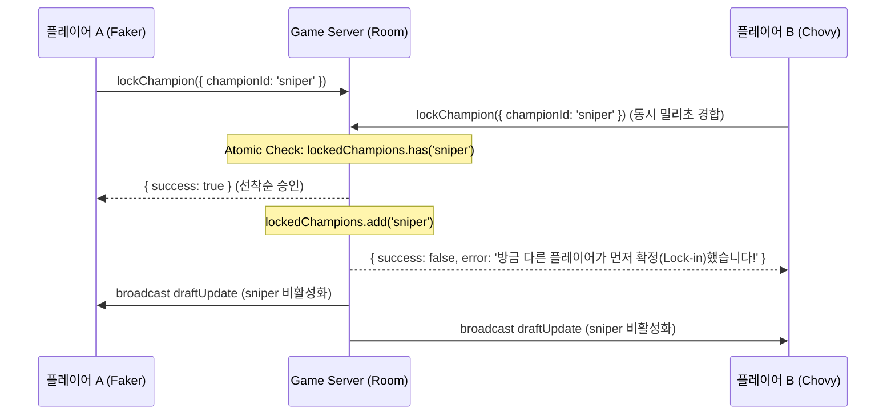

# 🏗️ Web MOBA 시스템 아키텍처 (System Architecture)

본 문서는 **Web MOBA (League of Legends 웹 아레나)**의 60 FPS 권위 서버 모델, 클라이언트 사이드 예측 및 보정, Three.js 기반 NPR 그래픽스 파이프라인, 미니언 AI 및 포탑 충돌 회피 시스템의 전체 아키텍처를 상세히 기술합니다.

---

## 1. 시스템 컴포넌트 구성도 (System Architecture Diagram)



---

## 2. 권위 서버 & 클라이언트 예측 모델 (Client-Side Prediction & Reconciliation)

본 엔진은 웹 환경의 네트워크 지연 체감을 없애기 위해 **신뢰할 수 있는 서버(Authoritative Server)**와 **클라이언트 사이드 예측(Client-Side Prediction)**의 하이브리드 파이프라인을 구축했습니다.

### 2.1 클라이언트 사이드 예측 (Client-Side Prediction)
* 플레이어가 마우스 우클릭 시, 서버 응답 패킷을 기다리지 않고 **로컬 즉시 반응(Immediate Responsiveness)**을 수행합니다:
  * 마우스 지점에 즉시 우클릭 녹색 핑 파티클 생성
  * 로컬 챔피언 목표 이동 벡터 즉시 설정
  * 초당 720도 각속도(`turnRate`) 기반 쿼터니언 `slerp` 회전 시작
* 동시에 서버로 경량 입력 패킷 전송:
  ```json
  socket.emit('playerMove', { x: targetX, y: targetY })
  ```

### 2.2 서버 틱 연산 & 스냅샷 브로드캐스트 (60Hz)
* 서버는 `dt = 0.0166s` (60 FPS) 고정 주기로 모든 플레이어, 미니언, 투사체, 포탑의 물리 연산을 계산합니다.
* 매 틱마다 `gameTick` 패킷을 전송하여 단일 진실의 근원(Single Source of Truth)을 유지합니다.

### 2.3 지수 보간 조정 및 오차 스냅 (Reconciliation)
* 수신된 서버 좌표와 클라이언트 예측 좌표 간의 오차 거리($\Delta d$)에 따라 동적 보정합니다:
  $$\Delta d = \sqrt{(x_{\text{pred}} - x_{\text{server}})^2 + (y_{\text{pred}} - y_{\text{server}})^2}$$
  * $\Delta d \le 0.5\text{ units}$: 플레이어가 눈치채지 못하도록 지수 감쇠 보간(Exponential Decay Lerp)으로 부드럽게 위치 수렴.
  * $\Delta d > 0.5\text{ units}$ (벽 충돌, 스턴, 침묵 등 서버 강제 이벤트): 클라이언트 위치를 서버 위치로 강제 스냅(Reconciliation)하여 Desync 원천 차단.

---

## 3. 선착순 챔피언 독점 락인 (Draft Pick Exclusivity)

Node.js의 단일 스레드 이벤트 루프(Single-Threaded Event Loop) 특성을 활용하여 동시 픽 경합(Race Condition)을 안전하게 방어합니다.



---

## 4. 미니언 패스파인딩 & 포탑 충돌 회피 (Minion AI & Flank Steering)

### 4.1 포탑 우회 회피 기동 (Flank Steering)
미니언은 라인 중심선($y = 800$)을 따라 진격하다가, 포탑 반경($r = 65$, 우회 감지 구역 $140\text{px}$)에 도달하면 직선 경로 대신 포탑 양옆 외곽선으로 우회 곡선을 형성합니다:
```javascript
// GameEngine.js
const turret = this.turrets.find(t => t.alive && Math.abs(t.x - m.x) < 140 && Math.abs(t.y - m.y) < 100);
if (turret) {
  // 포탑 상/하단으로 외곽선 우회 (laneOffset: ±110px)
  marchY = turret.y + (m.laneOffset > 0 ? 110 : -110);
}
```

### 4.2 하드 구조물 충돌 분리 (Hard Structure Collision Resolution)
포탑이나 넥서스 등 구조물과 미니언 간의 메쉬 겹침/파고듦을 방지하기 위해 매 틱 하드 충돌 분리 처리를 수행합니다:
$$dist = \sqrt{(m.x - s.x)^2 + (m.y - s.y)^2} < r_{\text{structure}} + r_{\text{minion}} + 6$$
충돌 발생 시, 법선 벡터 방향으로 미니언을 즉시 밀어냅니다:
$$m.x = s.x + nx \times (r_{\text{total}} + 6), \quad m.y = s.y + ny \times (r_{\text{total}} + 6)$$

### 4.3 포탑 공격 사거리 유지 (Stand-off Ring Formation)
* **근접 미니언**: 포탑 중심이 아닌 포탑 외곽 표면($r_{\text{turret}} + 18\text{px}$)에서 정지하여 원형 포위망을 형성하고 공격.
* **원거리 / 대포 미니언**: 180~220px 안전 사거리를 유지하며 원거리 마법/포탄 투사체 발사.

---

## 5. 전투 물리 및 판정 공식 (Combat & Hitbox Mechanics)

### 5.1 방어력 대미지 감쇄 공식 (League of Legends Standard)
$$\text{Effective Damage} = \text{Raw Damage} \times \left( \frac{100}{100 + \text{Armor}} \right)$$

### 5.2 0거리 나눗셈 보호 (Zero-Division Guard)
이동 및 투사체 방향 계산 시 플레이어 좌표와 목표 좌표가 일치할 때 발생하는 $0 / 0 = \text{NaN}$ 좌표 손상을 방지하기 위해 분모 안전 가드를 항상 적용합니다:
$$\text{safeDist} = \text{dist} > 0.001 \ ? \ \text{dist} : 1.0$$

### 5.3 군중 제어 효과 (CC State Machine)
* `STUN`: 이동 및 스킬 시전 불가, 이동 벡터 $0$ 강제.
* `AIRBORNE (Knockup)`: 공중으로 띄워지며 이동/스킬 강제 정지.
* `SLOW`: 이동 속도 $30\% \sim 60\%$ 감쇄.
* `SILENCE`: 기본 공격은 가능하나 스킬(QWER, DF) 시전 차단.
