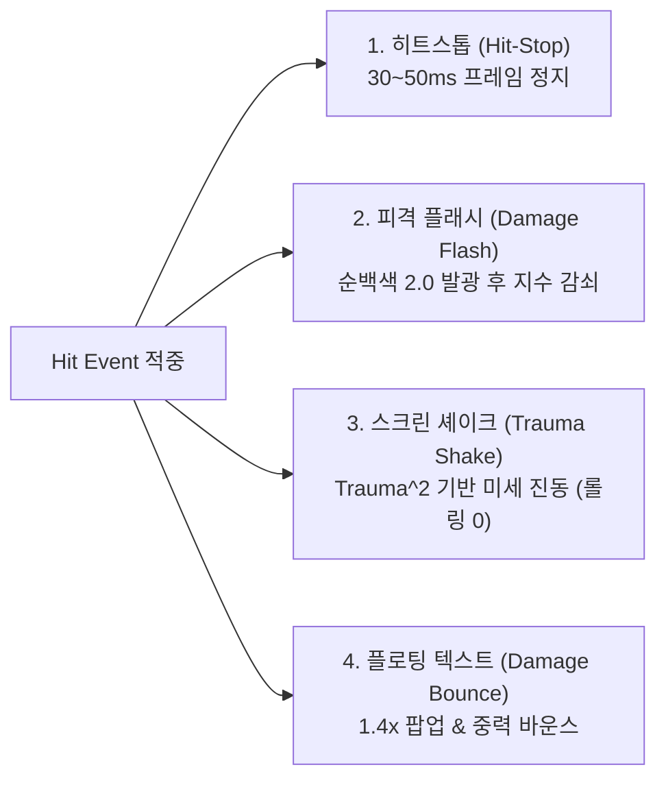

# 🎨 NPR 그래픽스 & 타격감 (Game Feel & Graphics Guide)

본 문서는 **Web MOBA** 엔진의 Three.js 기반 스타일라이즈드 툰 렌더링(NPR) 및 리그 오브 레전드 수준의 4단계 타격감(Combat Juice) 시스템 구현 명세를 상세히 설명합니다.

---

## 1. NPR 그래픽 파이프라인 (Non-Photorealistic Rendering)

본 엔진은 웹 브라우저의 플라스틱 장난감 질감(PBR의 전형적 한계)을 배제하고, 애니메이션/손맵 풍의 **스타일라이즈드 툰 그래픽**을 실현합니다.

### 1.1 머티리얼 구조 (`public/js/nprMaterial.js`)
* **3단계 그래디언트 맵 (3-Step Toon Ramp)**:
  * 부드러운 실사 음영 대신 `Highlight (1.0)`, `Midtone (0.65)`, `Shadow (0.3)`의 불연속 3단계 램프 텍스처를 적용하여 카툰 음영을 구현합니다.
* **커스텀 림 라이팅 (Rim Lighting Shader Chunk)**:
  * 캐릭터가 배경과 묻히지 않도록 외곽 실루엣에 발광 림 라이트를 삽입합니다:
  ```glsl
  // Three.js onBeforeCompile 삽입 셰이더
  vec3 viewDir = normalize(-vViewPosition);
  float rim = 1.0 - max(dot(vNormal, viewDir), 0.0);
  rim = smoothstep(0.65, 0.95, rim);
  gl_FragColor.rgb += rimColor.rgb * rim * rimIntensity;
  ```

### 1.2 인버티드 헐 외곽선 (Inverted Hull Mesh Outlines)
* 캐릭터 메쉬에 외곽선 전용 메쉬를 복제(Clone)하여 탑재합니다.
* 정점 셰이더에서 법선 벡터(Normal) 방향으로 미세하게 팽창시키고, 백페이스 렌더링(`THREE.BackSide`) 및 단색 검정/다크 브라운(`0x111111`)을 렌더링하여 안정적이고 굵기가 일정한 만화 외곽선을 형성합니다:
  ```glsl
  vec3 transformed = position + normal * outlineThickness;
  gl_Position = projectionMatrix * modelViewMatrix * vec4(transformed, 1.0);
  ```

---

## 2. 4단계 타격감 (Combat Juice) 시스템

전투 이벤트 발생 시 단순 수치 차감에 그치지 않고, 다음 4단계 연출 파이프라인을 **동기적으로 강제 트리거**합니다.



### 2.1 히트스톱 (Hit-Stop / Frame Freeze)
* 강력한 타격(치명타, 강력 스킬) 적중 시, 공격자와 피격자의 애니메이션 및 이동 델타타임을 30~50ms(약 2~3프레임) 동안 0으로 고정합니다.
* 공격의 물리적 질량감과 묵직한 타격감을 전달합니다.

### 2.2 피격 플래시 (Damage Flash)
* 피격 대상 메쉬의 Emissive 색상을 `0xffffff`(강도 2.0)으로 즉시 점멸시킨 뒤, 지수 감쇠(Exponential Decay)로 0.05초 안에 원래 색상으로 복구합니다.
* 피격 사실을 플레이어가 시각적으로 즉각 인지할 수 있도록 돕습니다.

### 2.3 카메라 셰이크 안정성 규칙 (Trauma-based Screen Shake)
* **일반 평타 & 미니언 전투 진동 완전 차단**: 미니언끼리 싸우거나 기본 공격을 할 때마다 화면이 흔들리면 시각적 피로도와 멀미가 심해지므로 완전 차단했습니다.
* **치명타 및 궁극기 전용**: 플레이어의 치명타 또는 궁극기 킬 등 결정타 발생 시에만 미세한 트라우마($Trauma \in [0, 1]$)를 누적합니다.
* **비선형 감쇠 공식**:
  $$\text{Offset} = \text{maxShakeOffset} \times Trauma^2 \times \text{PerlinNoise}(t)$$
* **카메라 롤링 절대 금지 (`maxShakeRoll = 0.0`)**: 쿼터뷰 지평선이 기우뚱거리지 않도록 카메라 회전 각도는 절대 비틀지 않습니다.

### 2.4 플로팅 대미지 텍스트 바운스 (Damage Bounce)
* 2D 캔버스 오버레이에 렌더링되는 대미지 숫자는 스폰 직후 $1.4\times$ 스케일로 폭발적으로 팝업됩니다.
* 수직 중력 가속도($g = 350\text{px/s}^2$)를 받아 낙하 후 바닥에서 1회 탄성 바운스(Elastic Bounce)하며 부드럽게 페이드아웃됩니다.

---

## 3. 안정적인 쿼터뷰 카메라 (`public/js/camera.js`)

* **화각 및 각도**: 리그 오브 레전드와 동일한 $45^\circ \sim 55^\circ$ 탑다운 쿼터뷰 유지.
* **화면 모드**:
  * **[Y] 키 고정 시점 (Fixed Camera)**: 내 챔피언을 항상 화면 중심에 고정.
  * **[Y] 키 자유 시점 (Free Camera)**: 화면 가장자리로 마우스 커서를 가져가면 해당 방향으로 부드럽게 카메라 패닝(Edge Panning).
  * **SPACEBAR 즉시 집중**: 자유 시점에서도 스페이스바를 누르면 내 챔피언 위치로 즉시 카메라 부드럽게 복귀.

---

## 4. 제로 가비지 컬렉션 (Zero-GC Architecture)

60 FPS 부드러운 프레임을 보장하기 위해 렌더링 루프와 서버 틱 루프 내부에서 동적 객체 할당을 원천 차단했습니다:

```javascript
// 모듈 상단에 선언된 정적 캐시 변수 재사용
const _v1 = new THREE.Vector3();
const _v2 = new THREE.Vector3();
const _q1 = new THREE.Quaternion();

function updateChampion(champion, dt) {
  // 금지: const target = new THREE.Vector3(x, y, z);
  // 권장:
  _v1.set(champion.targetX, 0, champion.targetZ);
  _v2.copy(_v1).sub(champion.mesh.position);
  // ...
}
```
* **파티클 풀링 (Particle Object Pool)**: 투사체 궤적 및 타격 파티클은 사전 할당된 정적 풀(500개)에서 `active` 플래그로 재활용합니다.
